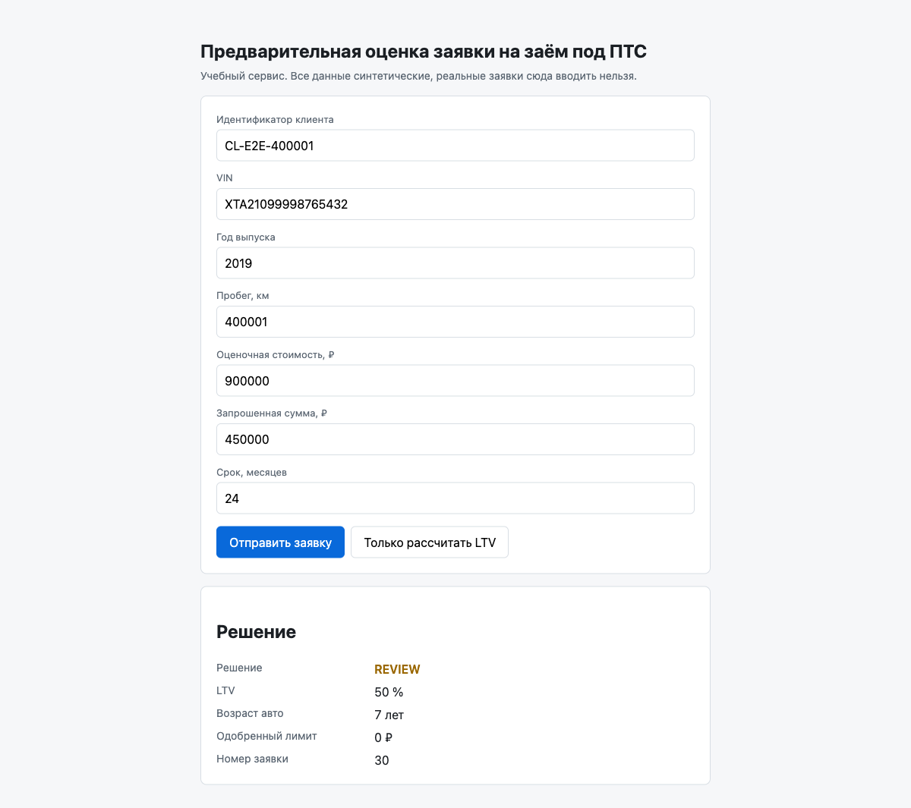

# E2E-проверка: заявка с пробегом 400001 км

Дата проверки: 2026-10-27. Инструмент: Playwright (MCP), браузер Chromium 156, headless-сессия.

## 1. Адрес приложения

`http://localhost:8080` — форма «Предварительная оценка заявки на заём под ПТС».

Backend отвечает и до заполнения формы: `GET /health` → 200. Форма отдаётся по `/`, API заявок — `POST /api/applications`.

## 2. Входные данные

Синтетические значения, реальных ПДн и VIN в проверке не использовалось.

| Поле формы | Значение | Комментарий |
|---|---|---|
| Идентификатор клиента | `CL-E2E-400001` | синтетический идентификатор для трассировки проверки |
| VIN | `XTA21099998765432` | 17 символов, без запрещённых I/O/Q — значение из формы сервиса |
| Год выпуска | `2019` | возраст авто 7 лет при max_age_years = 20 |
| **Пробег, км** | **`400001`** | проверяемое значение, порог решения `review_mileage_threshold_km` = 400000 |
| Оценочная стоимость, ₽ | `900000` | база для расчёта LTV |
| Запрошенная сумма, ₽ | `450000` | даёт LTV 50 % — ниже `approve_max` = 60 %, то есть решение упирается именно в пробег |
| Срок, месяцев | `24` | в диапазоне 3–48 |

LTV = 450000 / 900000 × 100 = **50.00 %** (попадает в зону approve, если бы не правило пробега).

## 3. Последовательность действий

1. `goto http://localhost:8080` — форма загрузилась, предзаполнены значения по умолчанию.
2. Заполнены все поля через Playwright (`fill` по ролям `textbox`/`spinbutton`); проверка через `FormData` подтвердила, что в форму ушли `mileage=400001`, `requested_amount=450000`, `market_value=900000`.
3. Нажата кнопка **«Отправить заявку»**.
4. Выполнен запрос `POST /api/applications` → `201 Created`, ответ: `{"id":30,"vehicle_age":7,"ltv":50.0,"decision":"review","approved_limit":0}`.
5. Снят accessibility-сnapshot страницы и прочитан `innerText` блока результата; текст и значения полей зафиксированы через `evaluate`.
6. Сделан full-page скриншот, сохранённый в `docs/setup/e2e_mileage_400001_review.png`.

Контрольные проверки границы (кнопка **«Только рассчитать LTV»**, `POST /api/ltv` — заявка **не сохраняется** в БД, `Номер заявки` = «не сохранена»):

- пробег `400000` → решение `approve`, лимит `450 000 ₽`;
- LTV ровно `60 %` (запрошенная сумма 540000 при стоимости 900000), пробег 84000 → решение `review`, лимит `0 ₽`.

## 4. Фактический результат и текст сообщения дословно

После отправки блок «Решение» показан, блок «Заявка не принята» скрыт (`errors.hidden = true`).

Видимый текст блока результата (снимок экрана, дословно):

```
Решение
Решение
REVIEW
LTV
50 %
Возраст авто
7 лет
Одобренный лимит
0 ₽
Номер заявки
30
```

Значения по полям:

| Поле | Значение на экране | Значение в DOM (`textContent`) | В ответе API |
|---|---|---|---|
| Решение | `REVIEW` | `review` | `"decision":"review"` |
| LTV | `50 %` | `50 %` | `"ltv":50.0` |
| Возраст авто | `7 лет` | `7 лет` | `"vehicle_age":7` |
| Одобренный лимит | `0 ₽` | `0 ₽` | `"approved_limit":0` |
| Номер заявки | `30` | `30` | `"id":30` |

Пояснения к наблюдаемому тексту:

- В DOM решение хранится строчными (`review`), регистр `REVIEW` — это CSS `text-transform: uppercase` в `frontend/styles.css:72` для класса `.decision`; CSS-класс подписи — `decision decision--review`.
- Валидация пробега не сработала: 400001 ≤ `max_mileage_km` = 500000, поэтому заявка принята и сохранена (номер 30), а не отклонена с кодом 422. Блок ошибок пуст.
- Одобренный лимит равен `0 ₽`, потому что лимит сейчас выдаётся только при решении `approve` (`backend/src/Domain/AssessmentService.php:39`).
- В консоли браузера единственная ошибка — несуществующий `favicon.ico` (404), к сценарию отношения не имеет.

## 5. Ссылка на скриншот



Файл: [`docs/setup/e2e_mileage_400001_review.png`](e2e_mileage_400001_review.png) (full-page PNG, снят сразу после отправки формы с пробегом 400001).

## 6. Совпадает ли результат с правилом про пробег

**Да, совпадает.**

Правило из `backend/config/rules.php:26` (`review_mileage_threshold_km` = 400000) и `backend/src/Domain/DecisionEngine.php:34-48`: при LTV < `approve_max` (60) решение `approve` понижается до `review`, если пробег строго больше 400000.

Проверка по шагам:

| Шаг | Ожидалось по правилу | Наблюдалось |
|---|---|---|
| LTV = 450000 / 900000 = 50 % | < 60 → зона approve | `50 %` ✅ |
| Пробег 400001 > 400000 | понижение approve → review | `review` ✅ |
| Решение | `review` | `REVIEW` ✅ |
| Одобренный лимит при `review` | 0 | `0 ₽` ✅ |

Контроль границы подтверждает, что порог применён именно как «строго больше»: при пробеге ровно `400000` сервис вернул `approve` с лимитом `450 000 ₽`, при `400001` — `review` с лимитом `0 ₽`. То есть расхождений с правилом про пробег нет; заявка корректно понижена с approve до review.

### Побочное наблюдение (не относится к правилу про пробег)

Расхождение между комментарием и кодом на границе LTV: в `backend/src/Domain/DecisionEngine.php:10` записано `LTV <= approve_max -> approve`, но в коде сравнение строгое — `if ($ltv < $this->approveMax)` (строка 36). На границе это даёт разные ответы, что подтверждено наблюдением: при LTV ровно `60 %` сервис вернул `review` и лимит `0 ₽`, тогда как комментарий предсказывает `approve`. Правило про пробег при этом не затронуто. Код, конфигурацию и тесты не менял — только зафиксировал наблюдение.

---

# Дополнение (2026-10-27): другие места, где видно правило или результат по пробегу

Проверка выполнена тем же инструментом Playwright. Искал не «по описанию», а обходом интерфейса: разбор DOM на подсказки, прогон всех экранов и API-маршрутов, проверка путей навигации.

## Просмотренные экраны и маршруты

| Экран / маршрут | Что проверял | Итог |
|---|---|---|
| `http://localhost:8080` (главная форма) | подсказки поля «Пробег, км», `title`, `placeholder`, `aria-describedby`, скрытый текст, `content` в CSS | подсказок нет |
| `http://localhost:8080` → отправка с пробегом `500001` | блок «Заявка не принята» (сообщение валидации) | **найдено** (место 1) |
| `http://localhost:8080` → «Только рассчитать LTV» | результат расчёта без сохранения | блок решения, пробег в нём не показан |
| `http://localhost:8080/api/applications/30` | карточка заявки | **найдено** (место 2) |
| `http://localhost:8080/api/applications?status=decided` | список заявок | решение есть, пробега в списке нет |
| `/applications`, `/applications/30`, `/application/30`, `/cards`, `/card`, `/rules`, `/admin`, `/decision`, `/decisions`, `/form`, `/help`, `/faq`, `/docs` | существует ли отдельная HTML-страница | все 404 — таких страниц нет |

Поиск порогов в отдаваемой статике (`/`, `/app.js`, `/styles.css`) — вхождений `400000`, `500000`, `review_mileage` нет ни одного.

## Место 1 (найдено): сообщение валидации пробега в блоке «Заявка не принята»

**Путь пользователя:** открыть `http://localhost:8080` → в поле «Пробег, км» ввести `500001` → нажать «Отправить заявку» → под формой появляется блок с красной рамкой «Заявка не принята».

**Текст на экране, дословно:**

```
Заявка не принята
• mileage: Пробег от 0 до 500000 км
```

**Точный текст элемента:** `mileage: Пробег от 0 до 500000 км` (HTML: `<li>mileage: Пробег от 0 до 500000 км</li>`, блок `#errors-list`, заголовок `<h2>Заявка не принята</h2>`). Блок «Решение» при этом скрыт, заявка не сохраняется, ответ сервера — 422 с телом `{"errors":{"mileage":"Пробег от 0 до 500000 км"}}`.

**Скриншот:** [`docs/setup/e2e_mileage_validation_message.png`](e2e_mileage_validation_message.png) (full-page PNG).

**Что это за правило:** ограничение валидации `vehicle.max_mileage_km` = 500000 из `backend/config/rules.php:23`. Это **не** порог решения `review_mileage_threshold_km` = 400000: в тексте сообщения 400000 не упоминается, и заявка с пробегом 400001 (проверка выше) валидацию проходит без ошибок.

## Место 2 (найдено): карточка заявки, где видны и пробег, и результат

**Путь пользователя:** в приложении такой ссылки нет — фронтенд (`frontend/app.js`) обращается только к `POST /api/applications` и `POST /api/ltv` и никогда не запрашивает карточку. Единственный способ увидеть её — ввести адрес вручную:

```
http://localhost:8080/api/applications/30
```

**Текст на экране, дословно** (браузер показывает JSON со встроенным «Pretty-print»):

```json
{
  "id": 30,
  "applicant_ref": "CL-E2E-400001",
  "requested_amount": 450000,
  "term_months": 24,
  "status": "decided",
  "created_at": "2026-10-27 13:40:54",
  "vin": "XTA21099998765432",
  "production_year": 2019,
  "mileage_km": 400001,
  "market_value": 900000,
  "ltv": "50.00",
  "decision": "review",
  "approved_limit": 0
}
```

Здесь видно одновременно и входной пробег (`"mileage_km": 400001`), и результат его проверки (`"decision": "review"`, `"approved_limit": 0`).

**Скриншот:** [`docs/setup/e2e_application_card_api.png`](e2e_application_card_api.png) (PNG).

**Оговорка:** это JSON-ответ API, а не отрисованная карточка в интерфейсе — отдельной HTML-страницы заявки не существует (`/applications/30` → 404). Число `400001` здесь отображается как сырое значение из БД, а порог 400000 в карточке не показан.

## Что не найдено

- **Подсказка поля «Пробег, км» с правилом** — не найдена: у `#mileage` нет атрибутов `title`/`placeholder`/`aria-describedby`, у лейбла только текст «Пробег, км», наведение ничего не показывает, в `styles.css` нет генерации подсказок через `content`/`::after`.
- **Отдельная HTML-карточка заявки** — не найдена: все разумные адреса (`/applications`, `/applications/30`, `/cards`, `/card` и др.) отдают 404; сервис отдаёт только форму `/` плюс JSON-API.
- **Пробег в списке заявок** (`GET /api/applications?status=decided`) — не найден: в элементах списка есть `decision` (`ltv`, `decision`, `approved_limit`), но вложенный объект `vehicle` содержит только `vin` и `production_year`; `mileage_km` в списке отсутствует.
- **Текст самого порога 400000** — не найден ни в одном пользовательском месте: ни в форме, ни в ошибках, ни в карточке, ни в списке, ни в отдаваемой статике. Пользователь видит только результат («review»), но не причину и не сам порог.
